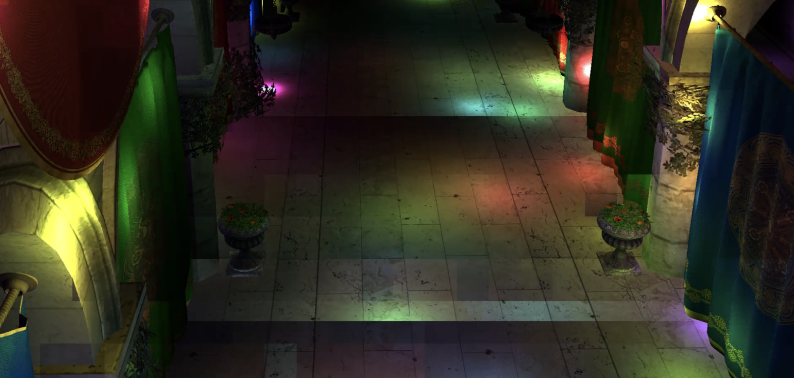
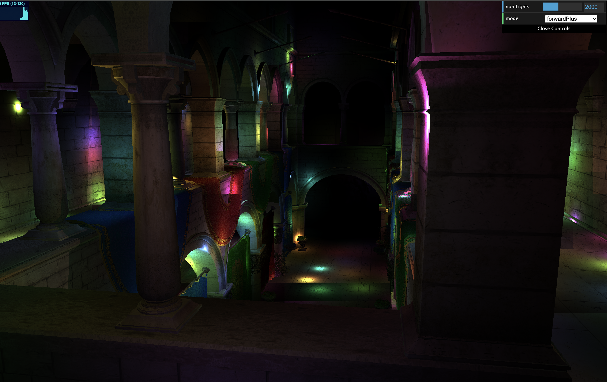
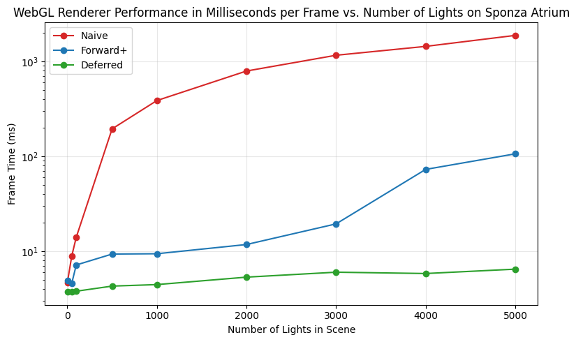

WebGL Forward+ and Clustered Deferred Shading
======================

**University of Pennsylvania, CIS 565: GPU Programming and Architecture, Project 4**

Rebecca Feng
* Tested on: Google Chrome Version 155.0.8059.80 (Official Build) (arm64) on Apple M4 Max

### Live Demo (click the image below)

### Demo Video/GIF
https://github.com/user-attachments/assets/838383f3-cdd7-4611-ba92-87dfd102c0fd

### Description
This project implements a WebGL renderer that showcases clustered shading in forward and deferred rendering. Clustered shading essentially requires us to divide up our scene in a voxelized grid with respect to our camera view, and specify which lights "overlap" which which cells. When combined with forward shading, it allows us to consider only the lights closest to our current grid cell, and therefore provide the most amount of lighting contribution to that part of the scene. This yields a big boost in our performance, since we don't have to consider lights who don't "intersect" with the grid cell that would otherwise provide little to no contribution to the cell's final color output. With deferred shading, we can further improve performance by rendering out the normals, position, and albedo beforehand and use that information in the actual render pass to perform lighting calculations per pixel, instead of per fragment.

To briefly outline the pros of deferred shading: without it, we would need to perform m * n draw calls, where m is the number of lights in our scene and n is the number of objects. With deferred, we speed up our implementation to m + n draw calls since we transform and rasterize each object once.
### Overview of Rendering Methods Used
#### Forward shading/Naive
Forward shading basically calculates all the lighting contribution for each fragment. In pseudocode, this would essnetially look like "for each fragment, for each light, ..." which yields a very expensive O(m*n) performance - especially when some fragments never get rendered, and also some lights may never contribute to the overall final color of the render. As outlined down below in the performance section, we see that the performance asymptotically falls off when we increase the number of lights in our scene. In order to make this method perform faster, we can make use of clustered shading, combined with forward + and deferred rendering, as described below.

#### Clustering (implemented with Forward+ and Deferred)
Clustered shading allows us to divide up our scene into a 3D grid, and assign lights to each cell that overlap with it. This is done in a separate compute shader. The overlapped lights supposedly provide the greatest light contribution/final output color to a cell, compared to other lights that would otherwise influence the output color to a somewhat negligible degree. Because of clustered shading, we don't have to consider all the lights in our scene as it pertains to a section of geometry which speeds up our implementation quite a bit (number of lights per geometry gets capped at a specified number; in this project, we hardcode 100). Furthermore, we also use log spacing in our camera's view in order to divide up our scene into smaller cells closer to the camera, and large slices furhter away from the camera (accounting for level of detail). However, because of the cap and because we perform clustering, sometimes grid artifacts do appear in our render due to some lights not being considered in each cell (when maybe they should have), as seen on the ground of the Sponza Atrium scene in the picture below:
    
    Clustering for this project is implemented together with Forward + and deferred shading. In order to further improve this feature, we may consider using some kind of adaptive sampling method, where if the lighting contribution starts to converge to some degree, then we can stop adding lights to consider in that particular cell. We could also implement depth based cluster culling, which culls clusters that are occluded and don't contain geometry.

#### Forward+ Shading
Forward+ shading is combined with clustering. For each fragment in the scene, we determine which clustered cell it is assigned to. We already determined each cell's list of lights in the compute shader, so we are able to simply iterate the list of those lights and calculate their contribution to that fragment. As a result, our performance improves from O(m * n) to essentially O(m * min(100, n)) (since 100 was our hardcoded number of lights per cell). This feature is further optimized with deferred shading, described below; however, we could have also used the depth buffer instead of the position buffer for our implementation as well so that less data would be put into the shader.

#### Deferred Shading

### Performance Analysis

#### Number of Lights in Scene

We base our performance metrics on the number of milliseconds it takes for our naive implementation (pure forward shading), forward+ shading with clustering, and deferred shading with clustering. Keep in mind that these metrics are specific to the device outlined at the beginning of this readme. The camera view of the Sponza Atrium test scene is depicted below (and tries to capture as many lights/geometry as possible in the camera view)

We choose to graph on a log scale to underline the performance difference between all three methods more clearly.

| Number of Lights in Scene | Naive (ms per frame) | Forward+ (ms) | Deferred (ms) |
|---------------------------|----------------------|---------------|---------------|
| 1                         | 4.69                 | 4.89          | 3.74          |
| 50                        | 8.91                 | 4.59          | 3.71          |
| 100                       | 14.02                | 7.15          | 3.78          |
| 500                       | 194.84               | 9.32          | 4.28          |
| 1000                      | 387.68               | 9.39          | 4.44          |
| 2000                      | 794.03               | 11.75         | 5.32          |
| 3000                      | 1164.59              | 19.39         | 6.00          |
|

 We see that the deferred rendering with clustering performs the best no matter how many lights there are in the scene. For Forward Plus, we see a steady increase in the amount of time it takes to complete a frame after more lights are added. However with the naive implementation, we see that the number of lights vs time it takes rises linearly.

Between Forward+ and Deferred shading, we clearly see that clustered deferred shading consistently outputs faster results. However, since deferred shading's main advantage is that it alleviates the number of draw calls needed and does best for scenes with high complexity/large amounts of geometry we may see little difference between Forward+ and Deferred shading methods otherwise - if not, forward+ shading performing better due to the overhead needed to write to the gbuffers in the prepass.

#### Cluster Dimensions

### Credits

- [Vite](https://vitejs.dev/)
- [loaders.gl](https://loaders.gl/)
- [dat.GUI](https://github.com/dataarts/dat.gui)
- [stats.js](https://github.com/mrdoob/stats.js)
- [wgpu-matrix](https://github.com/greggman/wgpu-matrix)
